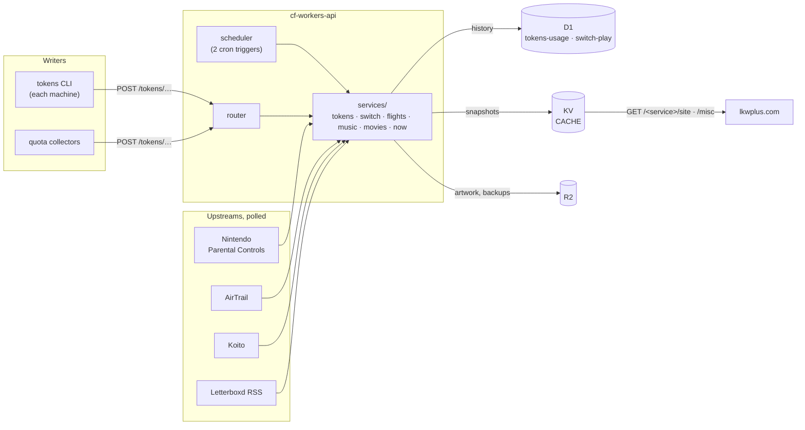

# cf-workers-api

[](https://github.com/synthpop123/cf-workers-api/actions/workflows/ci.yml)
[](LICENSE)

Every backend behind [lkwplus.com](https://lkwplus.com) — AI token usage, Nintendo Switch play time, a flight map, listening history and a film diary — in **one Cloudflare Worker**, served at [api.lkwplus.com](https://api.lkwplus.com).

Each service turns an upstream (a CLI's submissions, a vendor API, a self-hosted app, an RSS feed) into a small, versioned JSON view that a static site can render in one request. The interesting part is not any one service but the shape they share: views are precomposed **snapshots** in KV, refreshed by events and a scheduler rather than by TTLs, so a page load is one KV read and a revalidation is a ~0-byte `304`.



## Services

| Service | Source | Storage | Refreshed |
|---|---|---|---|
| [`tokens`](src/services/tokens) | the [`tokens`](https://github.com/missuo/tokens) CLI on each machine; quota collectors | D1 `tokens-usage`, R2 `tokens-archive` | on every submission and quota report |
| [`switch`](src/services/switch) | Nintendo Parental Controls (znma) API; eShop for prices and names | D1 `switch-play`, R2 `imagebed` | daily sync, 09:00 Asia/Shanghai |
| [`flights`](src/services/flights) | self-hosted [AirTrail](https://github.com/johanohly/AirTrail) | — | daily, at local midnight |
| [`music`](src/services/music) | self-hosted [Koito](https://github.com/gabehf/Koito) | — | every 5 minutes |
| [`movies`](src/services/movies) | Letterboxd RSS | R2 `imagebed` (posters) | every 3 hours |
| [`now`](src/services/now) | the stored music, movies and tokens views; Mastodon | — | every 5 minutes, right after music |

- **tokens** implements the official server's submission contract and merge semantics for the `tokens` CLI — per-device, per-day, per-client replace with a regression guard, parser-revision floors, authoritative coverage windows, the official consistency checks — and keeps the full usage matrix (device × date × client × model × provider, every token category, messages, cost). Its view is the dashboard at [lkwplus.com/tokens](https://lkwplus.com/tokens), including subscription quota cards reported by a collector that keeps the vendor credentials on its own machine.
- **switch** syncs daily play time from Nintendo's Parental Controls API, looks each title up once on the eShop (HK for the price, US for a consistent name) and mirrors cover art into R2.
- **flights** reads AirTrail and ships the map, not the log: airports, routes and tallies, never a single flight, flight number or seat.
- **music** composes Koito's stats, a dense year of daily plays and the latest listens into one document.
- **movies** parses the Letterboxd diary feed and mirrors each poster into R2.
- **now** is the home page's Now section: the latest listen and film, today's tokens and the newest Mastodon status as plain text, read from the other services' stored views rather than their upstreams.

## API

Reads are public and open to any origin. Every view answers `Cache-Control: no-cache` with a strong `ETag`, so browsers keep a copy, ask on every load, and get a `304` while nothing changed. `HEAD` works wherever `GET` does.

| Route | Returns |
|---|---|
| `GET /tokens/site` | the tokens dashboard view |
| `GET /switch/site` | Switch stats, a year of daily play and the catalog by lifetime play |
| `GET /flights/site` | airports, routes, airline and aircraft tallies, totals |
| `GET /music/site` | Koito stats, a dense year of daily plays, the latest listens |
| `GET /movies/site` | the latest diary entries |
| `GET /now/site` | `{listen, film, tokens, memo}`: the latest of each, today's token totals |
| `GET /misc` | `{"flights":…,"movies":…,"music":…,"switch":…}` — each exactly that service's view, or `null` if it has nothing to serve |
| `GET /health` | `{"ok":true,"services":[…]}` |

Writes take a bearer token:

| Route | Token | |
|---|---|---|
| `POST /tokens/api/submit` | `TOKENS_API_TOKEN` | a CLI submission |
| `GET /tokens/api/auth/token` | `TOKENS_API_TOKEN` | `tokens login --token` |
| `DELETE /tokens/api/settings/submitted-data` | `TOKENS_API_TOKEN` | wipe everything the account submitted |
| `POST /tokens/quota/{codex,claude}` | `TOKENS_API_TOKEN` | a subscription quota report |
| `POST /switch/sync` | `SWITCH_API_TOKEN` | run the Switch sync now |

The CLI joins its base URL with `/api/…`, so reporters run with `TOKENS_API_URL=https://api.lkwplus.com/tokens` and those three routes land under `/tokens/api/` verbatim. Everything this Worker names itself sits directly under the service prefix.

Every view carries a `schemaVersion`. Consumers should validate it strictly: a new version means the shape changed.

## How it works

### Services

A service is a directory under [`src/services/`](src/services) that default-exports a [`Service`](src/lib/service.ts): its name — also its path prefix and its KV namespace — its view, and any other routes. [`src/services/index.ts`](src/services/index.ts) lists them; the router serves each view at `GET /<name>/site`, and a test holds every route and key under its own name.

### Snapshots

A [snapshot](src/lib/snapshot.ts) is a service's view: a JSON document stored in KV under `<name>:site`, with its schema version, the calendar day it was composed as of, its ETag and when its bytes last changed kept in the entry's metadata. Reading one is a single KV lookup with no parse. Freshness comes from events, never from a TTL:

- **writes** — a service that owns its writes (tokens submissions and quota reports, the Switch sync) stores a new snapshot as the last step of the write;
- **the scheduler** — a service that polls an upstream is recomposed on its cadence;
- **reads** — only when there is no usable copy: none stored, one of another schema version (a deploy changed the shape), or one composed as of another calendar day (every view ends "today").

A composition whose bytes did not move writes nothing, which keeps KV writes — the scarcest free-plan resource — for actual changes and makes `Last-Modified` mean "last changed". If an inline composition fails, an earlier day's copy still answers; only a service with nothing stored at all returns `503`. There is deliberately no `caches.default` tier: it is the one layer no event could invalidate.

### Scheduler

The account-wide cron allowance is small (five triggers on the free plan), so the Worker uses two and each job declares its cadence within the trigger that fires it ([`src/schedule.ts`](src/schedule.ts)):

| Trigger | Jobs |
|---|---|
| `*/5 * * * *` | music then now every 5 min · movies every 3 h · flights daily at 00:00 local |
| `0 1 * * *` | the Switch sync |

Each trigger is its own invocation with its own CPU and subrequest budget, which is why the Switch sync — the one heavy job — has a trigger to itself. A test checks that the triggers match `wrangler.jsonc` and that every cadence lands on a tick.

### Artwork

Third-party artwork (Switch covers, Letterboxd posters) is copied into a public R2 bucket by [`src/lib/images.ts`](src/lib/images.ts), keyed by content (an upstream hash or version), so each image is copied once and served with an immutable cache header. A copy that fails leaves that image out; it never fails a composition.

### Privacy by construction

Every public body is built field by field from a hand-narrowed slice of its upstream. Internal device ids, account identities, PNRs, seat numbers, serial numbers and unlock codes are dropped at that step, and tests pin it. An upstream field rename fails a composition (the last good snapshot keeps serving) instead of silently changing a public contract.

## Deployment

Pushing to `main` is the deploy: Cloudflare [Workers Builds](https://developers.cloudflare.com/workers/ci-cd/builds/) runs `npm run check` and deploys only if it passes. Two things are not part of it:

- **Migrations** — after adding one, `npx wrangler d1 migrations apply <tokens-usage|switch-play> --remote`. They are append-only; D1 tracks them by filename.
- **Secrets** — `TOKENS_API_TOKEN`, `SWITCH_API_TOKEN`, `PCTL_SESSION_TOKEN` and `AIRTRAIL_API_KEY` live on the Worker (`npx wrangler secret put <NAME>`), declared under `secrets.required` in [`wrangler.jsonc`](wrangler.jsonc) so they are typed on `Env`.

Reporters for the tokens service are set up per machine: [docs/tokens-reporters.md](docs/tokens-reporters.md).

## Development

```sh
cp .dev.vars.example .dev.vars   # local secrets
npm run dev                      # wrangler dev, local D1/KV/R2
npm run check                    # types + format + typecheck + tests
npm run format                   # Biome
```

Tests run inside `workerd` through [`@cloudflare/vitest-pool-workers`](https://developers.cloudflare.com/workers/testing/vitest-integration/) against real (Miniflare-backed) D1, KV and R2, with migrations applied per test file. Every upstream is mocked; nothing leaves the machine.

```
src/
  index.ts          fetch + scheduled
  services/         one directory per service, and the registry (index.ts)
  schedule.ts       cron triggers → jobs and their cadence
  misc.ts           GET /misc
  lib/              router, snapshot store, service type, image mirror, HTTP helpers
  env.ts            Env, generated from wrangler.jsonc
migrations/         one directory per D1 database (append-only)
scripts/tokens/     quota collectors and reporter unit files
docs/               operational guides
public/             the service page at /
test/               mirrors src/
```

## Contributing

See [CONTRIBUTING.md](CONTRIBUTING.md). Commits follow [Conventional Commits](https://www.conventionalcommits.org).

## License

[MIT](LICENSE)
